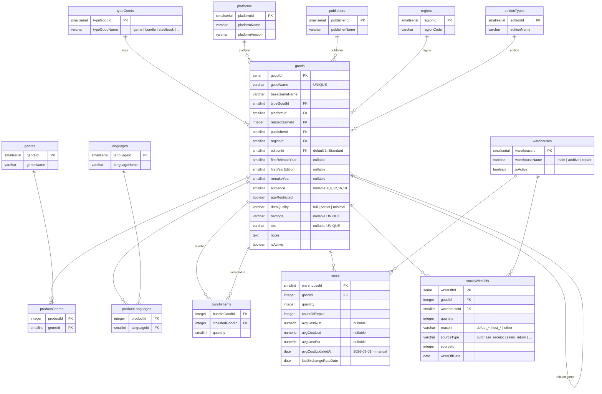
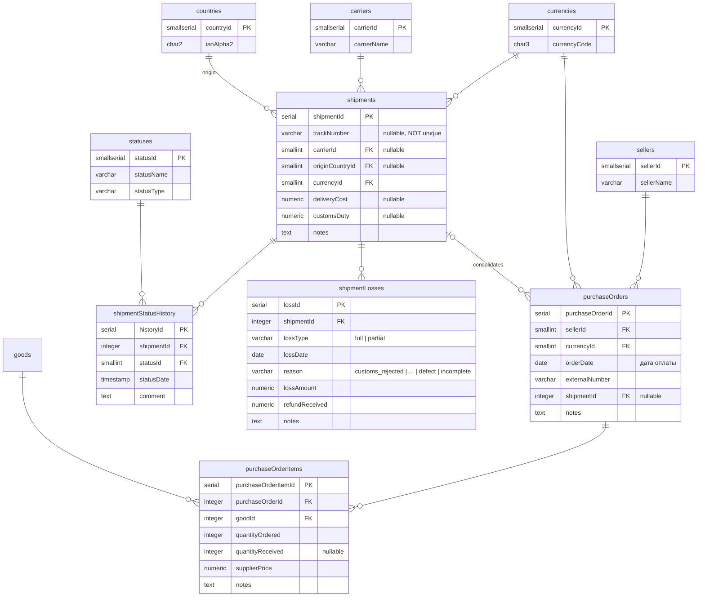
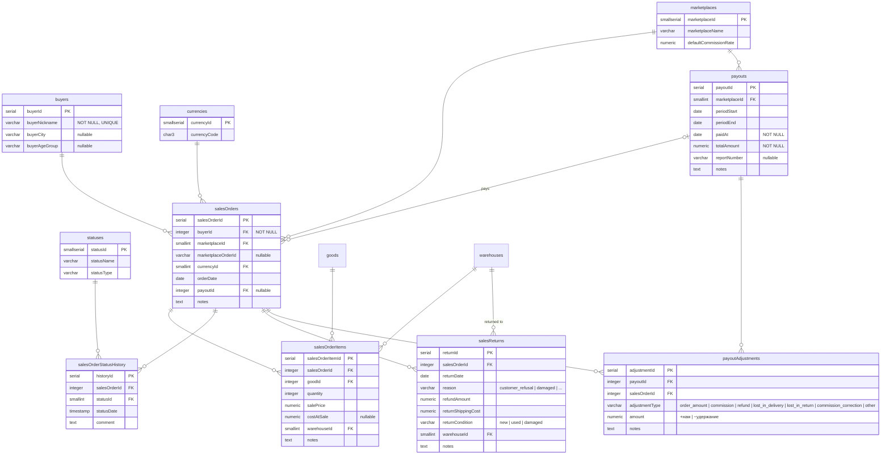

# ER-диаграмма

Версия: 1.0
Последнее обновление: 2026-10-23

Диаграмма сгенерирована из модели данных (файлы `04`, `041`, `042`, `043`). Рендерится GitHub нативно через Mermaid. Для редактирования удобно использовать VS Code с расширением `Markdown Preview Mermaid Support`.

Документ разбит на 5 секций:
1. Обзор (все таблицы, только связи)
2. Справочники (детально)
3. Товары и склад (детально)
4. Закупка (детально)
5. Продажа (детально)

---

## 1. Обзор

Общая структура связей между всеми 34 таблицами. Для деталей — см. секции ниже.

```mermaid
erDiagram
    %% ===== СПРАВОЧНИКИ =====
    countries
    regions
    platforms
    genres
    languages
    editionTypes
    typeGoods
    currencies
    marketplaces
    statuses
    exchangeRates
    publishers
    purchasePlatforms
    carriers
    sellers

    %% ===== ТОВАРЫ И СКЛАД =====
    goods
    productGenres
    productLanguages
    bundleItems
    warehouses
    stock
    stockWriteOffs

    %% ===== ЗАКУПКА =====
    purchaseOrders
    purchaseOrderItems
    shipments
    shipmentStatusHistory
    shipmentLosses

    %% ===== ПРОДАЖА =====
    buyers
    salesOrders
    salesOrderItems
    salesOrderStatusHistory
    salesReturns
    payouts
    payoutAdjustments

    %% ===== СВЯЗИ СПРАВОЧНИКОВ =====
    countries ||--o{ publishers : ""
    countries ||--o{ purchasePlatforms : ""
    countries ||--o{ sellers : ""
    countries ||--o{ shipments : ""
    currencies ||--o{ exchangeRates : "from"
    currencies ||--o{ exchangeRates : "to"
    purchasePlatforms ||--o{ sellers : ""
    carriers ||--o{ shipments : ""
    marketplaces ||--o{ salesOrders : ""
    marketplaces ||--o{ payouts : ""
    statuses ||--o{ shipmentStatusHistory : ""
    statuses ||--o{ salesOrderStatusHistory : ""

    %% ===== СВЯЗИ ТОВАРОВ И СКЛАДА =====
    typeGoods ||--o{ goods : ""
    platforms ||--o{ goods : ""
    publishers ||--o{ goods : ""
    regions ||--o{ goods : ""
    editionTypes ||--o{ goods : ""
    goods ||--o{ goods : "related game"
    goods ||--o{ productGenres : ""
    genres ||--o{ productGenres : ""
    goods ||--o{ productLanguages : ""
    languages ||--o{ productLanguages : ""
    goods ||--o{ bundleItems : "bundle"
    goods ||--o{ bundleItems : "included in"
    goods ||--o{ stock : ""
    warehouses ||--o{ stock : ""
    goods ||--o{ stockWriteOffs : ""
    warehouses ||--o{ stockWriteOffs : ""

    %% ===== СВЯЗИ ЗАКУПКИ =====
    sellers ||--o{ purchaseOrders : ""
    currencies ||--o{ purchaseOrders : ""
    purchaseOrders ||--o{ purchaseOrderItems : ""
    goods ||--o{ purchaseOrderItems : ""
    shipments o|--o{ purchaseOrders : "consolidates"
    currencies ||--o{ shipments : ""
    shipments ||--o{ shipmentStatusHistory : ""
    shipments ||--o{ shipmentLosses : ""

    %% ===== СВЯЗИ ПРОДАЖИ =====
    buyers ||--o{ salesOrders : ""
    currencies ||--o{ salesOrders : ""
    salesOrders ||--o{ salesOrderItems : ""
    goods ||--o{ salesOrderItems : ""
    warehouses ||--o{ salesOrderItems : ""
    salesOrders ||--o{ salesOrderStatusHistory : ""
    salesOrders ||--o{ salesReturns : ""
    warehouses ||--o{ salesReturns : ""
    payouts o|--o{ salesOrders : "pays"
    payouts ||--o{ payoutAdjustments : ""
    salesOrders ||--o{ payoutAdjustments : ""
```

---

## 2. Справочники (детально)

```mermaid
erDiagram
    countries {
        smallserial countryId PK
        char2 isoAlpha2 "UNIQUE"
        char3 isoAlpha3 "UNIQUE"
        varchar countryName
        varchar countryNameRu
        boolean isActive
    }

    regions {
        smallserial regionId PK
        varchar regionCode "UNIQUE"
        varchar regionName
        smallint sortOrder
        boolean isActive
    }

    platforms {
        smallserial platformId PK
        varchar platformName
        varchar platformVersion
        smallint sortOrder
        boolean isActive
    }

    genres {
        smallserial genreId PK
        varchar genreName "UNIQUE"
        smallint sortOrder
        boolean isActive
    }

    languages {
        smallserial languageId PK
        char2 languageCode "UNIQUE"
        varchar languageName
        varchar languageNameRu
        smallint sortOrder
        boolean isActive
    }

    editionTypes {
        smallserial editionId PK
        varchar editionName "UNIQUE"
        smallint sortOrder
        boolean isActive
    }

    typeGoods {
        smallserial typeGoodId PK
        varchar typeGoodName "UNIQUE"
        smallint sortOrder
        boolean isActive
    }

    currencies {
        smallserial currencyId PK
        char3 currencyCode "UNIQUE"
        varchar currencyName
        varchar currencySymbol
        boolean isCrypto
        smallint sortOrder
        boolean isActive
    }

    marketplaces {
        smallserial marketplaceId PK
        varchar marketplaceName "UNIQUE"
        numeric defaultCommissionRate
        smallint sortOrder
        boolean isActive
    }

    statuses {
        smallserial statusId PK
        varchar statusName "UNIQUE with statusType"
        varchar statusType "purchase | sale"
        smallint sortOrder
        boolean isActive
    }

    exchangeRates {
        serial exchangeRateId PK
        date rateDate
        smallint currencyFromId FK
        smallint currencyToId FK
        numeric rate
        varchar source
    }

    publishers {
        smallserial publisherId PK
        varchar publisherName "UNIQUE"
        smallint countryId FK
        smallint sortOrder
        boolean isActive
    }

    purchasePlatforms {
        smallserial purchasePlatformId PK
        varchar purchasePlatformName "UNIQUE"
        smallint countryId FK
        smallint sortOrder
        boolean isActive
    }

    carriers {
        smallserial carrierId PK
        varchar carrierName "UNIQUE"
        varchar trackingUrlTemplate
        smallint sortOrder
        boolean isActive
    }

    sellers {
        smallserial sellerId PK
        varchar sellerName
        smallint purchasePlatformId FK
        varchar marketplaceSellerId "nullable"
        varchar sellerType "shop | private | forwarder"
        smallint countryId FK "nullable"
        varchar contactEmail
        varchar website
        text notes
        smallint sortOrder
        boolean isActive
    }

    countries ||--o{ publishers : "country"
    countries ||--o{ purchasePlatforms : "country"
    countries ||--o{ sellers : "country"
    currencies ||--o{ exchangeRates : "from"
    currencies ||--o{ exchangeRates : "to"
    purchasePlatforms ||--o{ sellers : "platform"
```

---

## 3. Товары и склад (детально)

---

## 4. Закупка (детально)

---

## 5. Продажа (детально)

---

## Как читать диаграмму

**Кардинальность (символы Mermaid):**

| Символ | Значение |
|---|---|
| `\|\|` | Ровно один (1) |
| `\|o` | Ноль или один (0..1) — nullable FK |
| `}\|` | Один или более (1..N) |
| `}o` | Ноль или более (0..N) |
| `\|\|--o{` | Один-ко-многим (1:N) |
| `o\|--o{` | Ноль-или-один-ко-многим (0..1 : 0..N) |

**Обозначения полей:**

| Обозначение | Значение |
|---|---|
| `PK` | Первичный ключ |
| `FK` | Внешний ключ |
| `nullable` | Может быть `NULL` |
| `UNIQUE` | Уникальное значение |

**Группы таблиц:**

- **Справочники** — `countries`, `regions`, `platforms`, `genres`, `languages`, `editionTypes`, `typeGoods`, `currencies`, `marketplaces`, `statuses`, `exchangeRates`, `publishers`, `purchasePlatforms`, `carriers`, `sellers`.
- **Товары и склад** — `goods`, `productGenres`, `productLanguages`, `bundleItems`, `warehouses`, `stock`, `stockWriteOffs`.
- **Закупка** — `purchaseOrders`, `purchaseOrderItems`, `shipments`, `shipmentStatusHistory`, `shipmentLosses`.
- **Продажа** — `buyers`, `salesOrders`, `salesOrderItems`, `salesOrderStatusHistory`, `salesReturns`, `payouts`, `payoutAdjustments`.

**Ключевые связи между контурами (закупка ↔ продажа):**

Закупка и продажа **не связаны напрямую**. Пересечение — только через `stock` (закупка увеличивает `quantity`, продажа уменьшает). Это позволяет независимо развивать оба контура.

**Особые связи:**

- `goods ↔ goods` — self-reference (`relatedGameId`). Например, стилбук к игре Doom Eternal.
- `goods ↔ bundleItems ↔ goods` — сборник (`bundleGoodId`) содержит игры (`includedGoodId`).
- `purchaseOrders ↔ shipments` — 1 PO → 0..1 shipment (nullable `shipmentId`). 1 shipment → 0..N PO (консолидация).
- `payouts ↔ salesOrders` — 1 sale order → 0..1 payout (nullable `payoutId`). 1 payout → 0..N sale orders.

---

## Как редактировать

1. **VS Code** + расширение `Markdown Preview Mermaid Support` (ID: `bierner.markdown-mermaid`) — live-предпросмотр в редакторе.
2. **GitHub** — рендерит автоматически при просмотре файла. Ничего дополнительно не нужно.
3. **Mermaid Live Editor** (`mermaid.live`) — вставить код, посмотреть, поправить, скопировать обратно.

При изменении схемы:
- Правите `04_модель_данных.md` (или `041`/`042`/`043`) — источник истины.
- Синхронизируете `ER_diagram.md`.
- Коммитите оба файла. GitHub покажет обновлённую диаграмму и дифф изменений.

---

## История изменений

**v1.0** (2026-10-23): первая версия. 34 таблицы, 5 секций (обзор + 4 домена). Mermaid `erDiagram`, рендерится GitHub нативно.