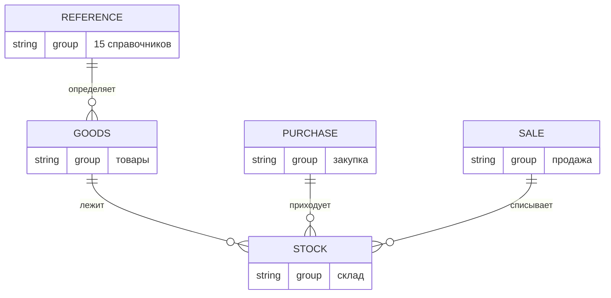

# ER: Обзор

Схема верхнего уровня. Показывает связи между **группами** таблиц. Детали — в дочерних файлах.

**Дочерние диаграммы:**
- [Справочники: базовые](ER_ref_basic.md) — страны, регионы, валюты, курсы
- [Справочники: игровые](ER_ref_game.md) — платформы, жанры, языки, издания, типы, издатели
- [Справочники: торговые](ER_ref_trade.md) — маркетплейсы, статусы, площадки закупки, службы доставки, поставщики
- [Товары](ER_goods.md) — товары, жанры/языки (M2M), сборники
- [Склад](ER_stock.md) — склады, остатки, списания
- [Закупка](ER_purchase.md) — заказы, посылки, статусы, потери
- [Продажа: заказы](ER_sale_orders.md) — покупатели, заказы, позиции, статусы
- [Продажа: выплаты](ER_sale_payouts.md) — возвраты, выплаты, корректировки

**Ключевая идея:** закупка и продажа **не связаны напрямую**. Пересечение — только через `stock`: закупка увеличивает `quantity`, продажа уменьшает.