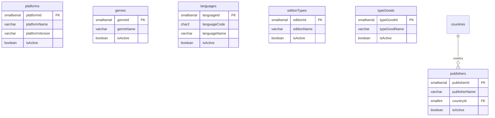

# ER: Справочники — игровые

Платформы, жанры, языки, типы изданий, типы товаров, издатели.

**Связи:**
- `publishers.countryId` → `countries` — страна базирования
- `platforms`, `genres`, `languages`, `editionTypes`, `typeGoods` — самостоятельные справочники

**Ключевые значения:**
- `platforms`: PC, PlayStation 4/5, Xbox One/Series, Switch 1/2, Sega Mega Drive...
- `genres`: Action, Horror, Strategy, RPG...
- `languages`: en, ru, ja, ...
- `editionTypes`: Standard (id=1), Deluxe, Collector's, Steelbook...
- `typeGoods`: **game**, **bundle**, steelbook, gamepad, figure...