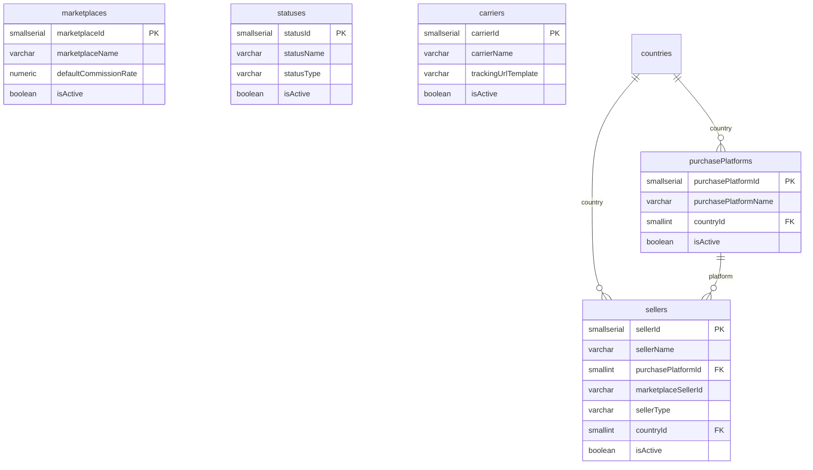

# ER: Справочники — торговые

Маркетплейсы (продажа), статусы, площадки закупки, службы доставки, поставщики.

**Связи:**
- `purchasePlatforms.countryId` → `countries` — страна площадки
- `sellers.purchasePlatformId` → `purchasePlatforms` — где зарегистрирован
- `sellers.countryId` → `countries` — страна регистрации (опционально)

**Ключевые значения:**
- `marketplaces` (продажа): OZON, Avito, WB, YM, VK, SelfSite
- `statuses`: `statusType IN ('purchase','sale')`, `UNIQUE (statusName, statusType)`
- `purchasePlatforms` (закупка): eBay US, eBay EU, Amazon JP, Play-Asia, CDJapan...
- `carriers`: DHL, FedEx, USPS, EMS, Почта России, СДЭК...
- `sellers`: `sellerType IN ('shop','private','forwarder')`. Физлица группируем — одна запись на площадку/регион