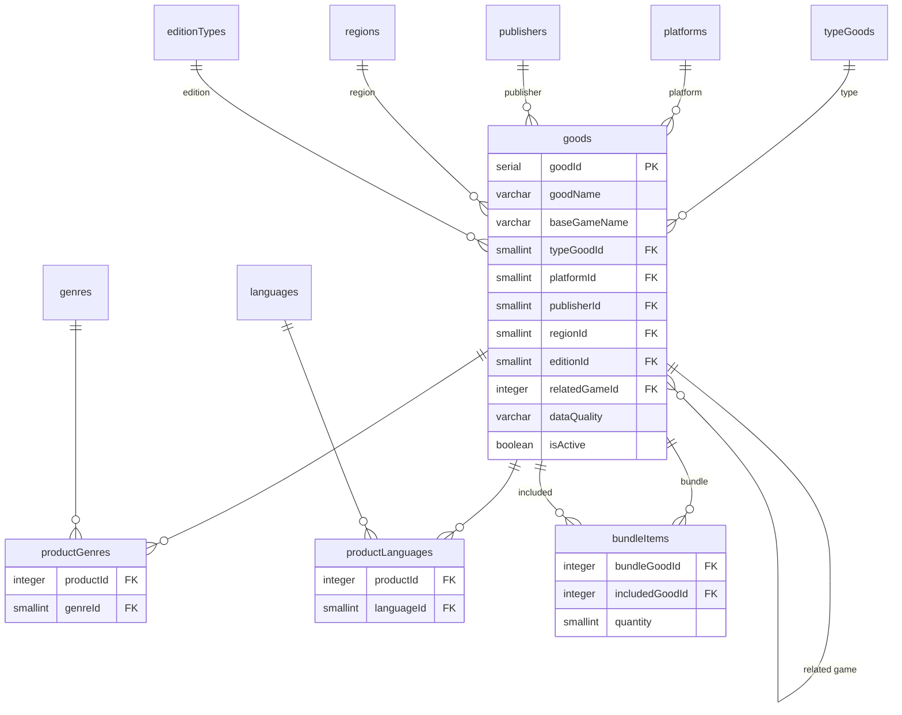

# ER: Товары

Товары (SKU), M2M с жанрами и языками, состав сборников.

**Ключевые связи:**
- `goods.relatedGameId` → `goods` — self-reference (стилбук → игра)
- `productGenres` — M2M между товаром и жанром
- `productLanguages` — M2M между товаром и языком (English привязывается автоматически)
- `bundleItems` — M2M между сборником (`typeGoodId = 'bundle'`) и входящими играми

**Ключевые поля:**
- `dataQuality`: `full` / `partial` / `minimal`
- `editionId DEFAULT 1` (Standard)
- `firstReleaseYear`, `firstYearEdition`, `remakeYear` — три разных года для аналитики «волн популярности»