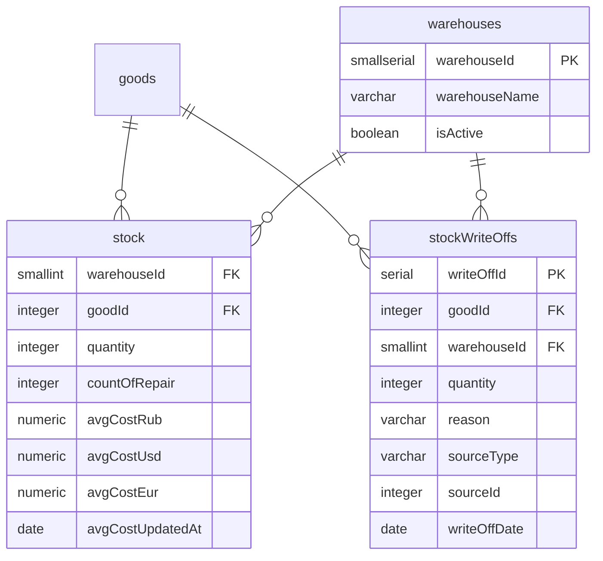

# ER: Склад

Склады, остатки, списания.

**Ключевые связи:**
- `stock` — составной PK `(warehouseId, goodId)`. Остаток товара на конкретном складе
- `stockWriteOffs.sourceId` — полиморфная ссылка (`purchaseOrderItemId`, `salesReturnId`, `salesOrderId`)

**Ключевые поля:**
- `stock.quantity` — физическое количество (включая `countOfRepair`)
- `availableForSale = quantity − countOfRepair` (вычисляется)
- `avgCost*` — `NULL` = цена неизвестна. `avgCostUpdatedAt = '2026-09-01'` — флаг «миграционная цена»
- `stockWriteOffs.reason`: `defect_on_receipt` / `defect_on_return` / `lost_in_delivery` / `lost_in_return` / `other`
- `stockWriteOffs.sourceType`: `purchase_receipt` / `sales_return` / `sales_delivery` / `manual`

**Стартовые склады:** `main`, `archive`, `repair`