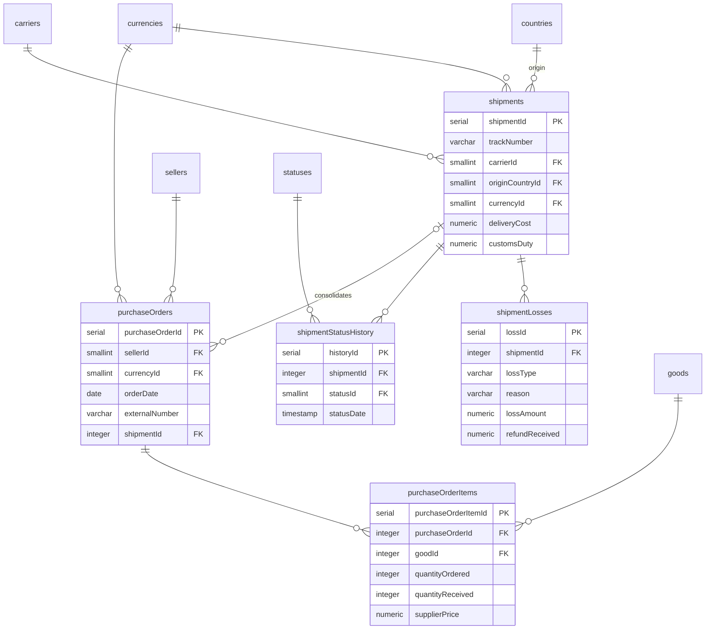

# ER: Закупка

Заказы на закупку, посылки, статусы посылки, потери.

**Ключевые связи:**
- `purchaseOrders.shipmentId` → `shipments` — **1 PO → 1 Shipment** (nullable, пока не привязан). Одна посылка → много заказов (консолидация)
- `shipmentStatusHistory` — история статусов **посылки** (у заказа своей истории нет)
- `shipmentLosses` — потери посылки (полные/частичные, брак, некомплект)

**Ключевые поля:**
- `purchaseOrders.orderDate` — **дата оплаты** (предоплата), 1-я ключевая дата
- `purchaseOrderItems.quantityReceived` — результат приёмки, `NULL` до приёмки
- `shipments.trackNumber` — **не уникален** (разные службы)
- `shipmentStatusHistory.statusDate` — даты для `at_carrier`, `shipped`, `customs`, `received`
- `shipmentLosses.lossType`: `full` / `partial`
- `shipmentLosses.reason`: `customs_rejected` / `destroyed` / `returned_to_seller` / `lost_in_transit` / `defect` / `incomplete`

**4 ключевые даты закупки:**
1. `orderDate` (поле) — оплата
2. `at_carrier` (история) — поступление в СД
3. `shipped` (история) — отправка
4. `received` (история) — получение