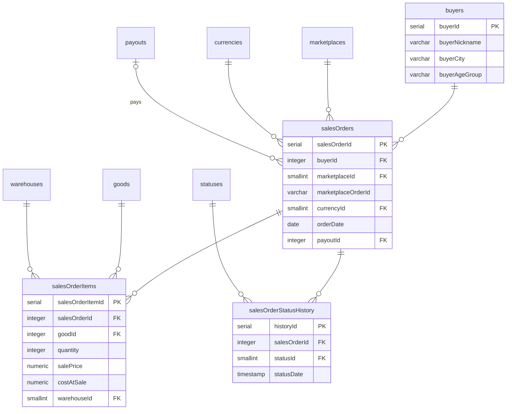

# ER: Продажа — заказы

Покупатели, заказы, позиции, история статусов.

**Ключевые связи:**
- `salesOrders.buyerId` — **NOT NULL**. Для гостей — автогенерированный `buyerNickname` (`guest_2026_0001`)
- `salesOrders.payoutId` → `payouts` — nullable, заполняется при выплате
- `salesOrderItems.costAtSale` — `stock.avgCostRub` на момент продажи. `NULL` = «себестоимость неизвестна»
- `salesOrderItems.warehouseId` — с какого склада списан товар

**Ключевые поля:**
- `buyers.buyerNickname` — **NOT NULL UNIQUE**. Минимум ПД
- `salesOrders` — **без `commissionRate`/`commissionAmount`**. Комиссия — в `payoutAdjustments`
- `salesOrderStatusHistory`: `paid` → `shipped` → `received` / `refusal`. **Без `collected`**

**3 ключевые даты продажи (заказ):**
1. `orderDate` — оплата
2. `shipped` — отправка
3. `received` / `refusal` — получение / отказ