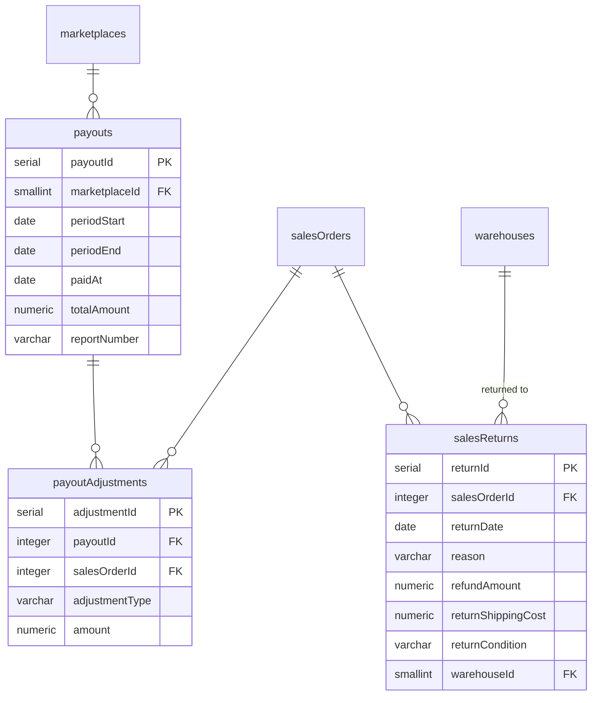

# ER: Продажа — выплаты

Возвраты товара, выплаты маркетплейсов, детализация по заказам.

**Ключевые связи:**
- `salesReturns.salesOrderId` → `salesOrders` — возврат товара (товар **физически вернулся**)
- `payouts` → `marketplaces` — пакетная выплата от маркетплейса
- `payoutAdjustments` — детализация выплаты по заказам (строки)

**Ключевые поля:**
- `salesReturns.returnCondition`: `new` / `used` / `damaged`
- `payouts.paidAt`, `totalAmount` — **NOT NULL** (из отчёта OZON)
- `payoutAdjustments.adjustmentType`: `order_amount` (+) / `commission` (−) / `refund` (−) / `lost_in_delivery` (+) / `lost_in_return` (+) / `commission_correction` (±) / `other` (±)
- `payoutAdjustments.amount` — знак важен: `+` нам, `−` удержание

**Сверка:** `payouts.totalAmount = SUM(payoutAdjustments.amount)` для данного `payoutId`

**4-я ключевая дата продажи:** `salesReturns.returnDate` — дата фактического возврата товара

**Важно:**
- **`salesReturns`** — только когда товар физически вернулся
- **`lost_in_delivery` / `lost_in_return`** — НЕ возврат. Товар не вернулся. OZON компенсирует полную стоимость. Товар списывается через `stockWriteOffs`
- **`lost_in_delivery`** — доставку до потребителя не оплачиваем
- **`lost_in_return`** — доставку оплатили (товар был доставлен, потом возвращался)