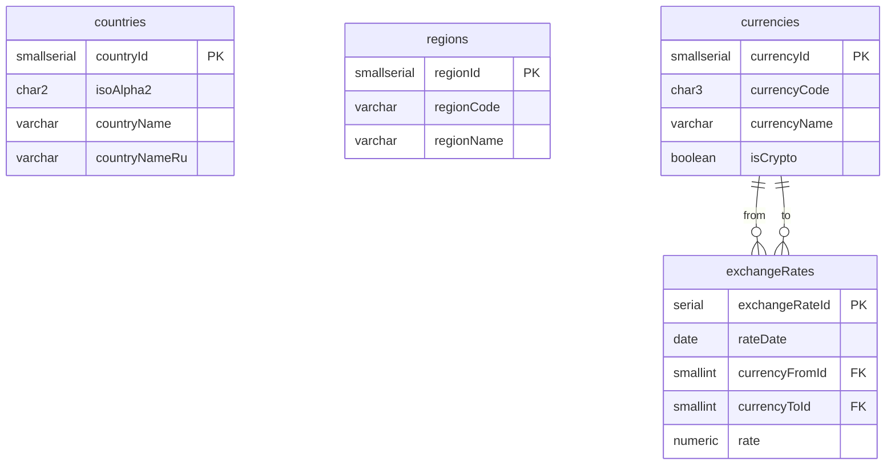

# ER: Справочники — базовые

Страны, регионы, валюты, курсы.

**Связи:**
- `exchangeRates.currencyFromId` → `currencies.currencyId` — из какой валюты
- `exchangeRates.currencyToId` → `currencies.currencyId` — в какую валюту
- `countries`, `regions` — самостоятельные справочники, связей между собой нет